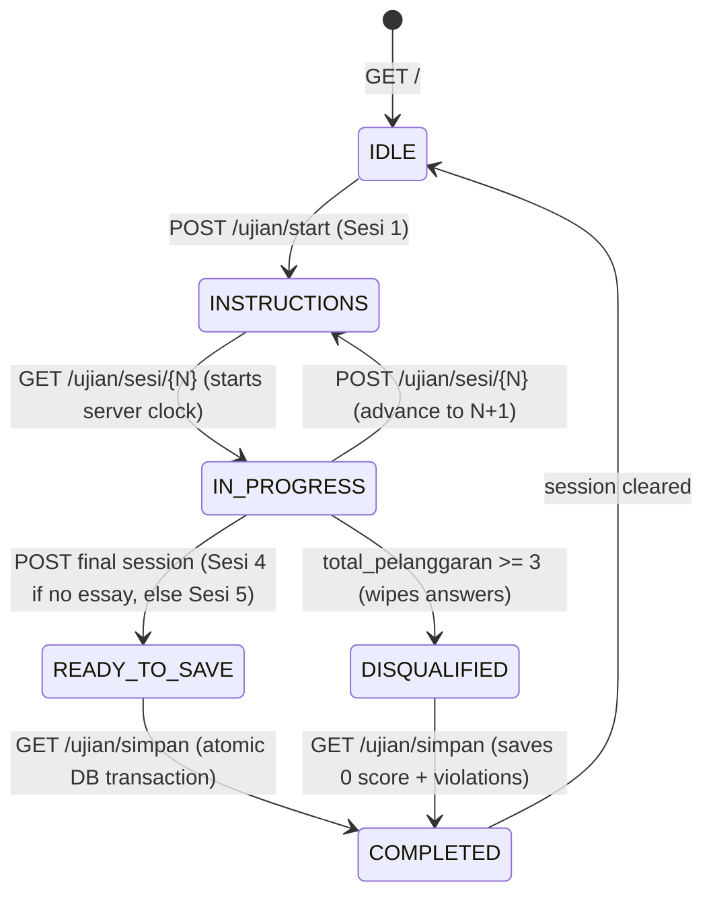

# AI Agent & Developer Guide (`AGENTS.md`)

This guide is designed for AI coding agents and human developers maintaining, auditing, or extending **Gosyen Assessment** (`gosyen-TKD`), a Laravel 10 online psychological (IST) & technical case-study testing platform.

---

## 📌 Project Overview
**Gosyen Assessment** evaluates job candidates across 4 timed Intelligenz-Struktur-Test (IST) cognitive subtests plus a database-driven technical essay & case-study session (`Sesi 5`), backed by an Admin/Psychologist dashboard for question banks, company/position mapping, dynamic session timers, rubrics, and automated scoring/export (Excel, PDF, Word).

### Core Stack
*   **Backend:** Laravel 10 (`PHP ^8.1`), MySQL / MariaDB, DomPDF (`barryvdh/laravel-dompdf`)
*   **Frontend:** Blade templates, Bootstrap 5, Custom CSS design tokens (Light/Dark tri-state), Vanilla JS state machines
*   **Localization:** Bilingual Indonesian (`id`, default) and English (`en`) via `lang/en.json` and `lang/en_sesi5.json`
*   **PWA & Assets:** `public/sw.js`, `public/manifest.json`, visual reasoning images in `public/gambar/visual_reasoning/{1-20}.png`

---

## 📂 Key Paths

*   **Domain Enums & State Machine:**
    *   [ExamPhase.php](file:///Users/attraqtia/Documents/GitHub/gosyen-TKD/app/Enums/ExamPhase.php) — Candidate exam lifecycle phases (`idle`, `instructions`, `in_progress`, `ready_to_save`, `disqualified`, `completed`).
    *   [ExamSession.php](file:///Users/attraqtia/Documents/GitHub/gosyen-TKD/app/Enums/ExamSession.php) — Single source of truth for Sesi 1–5 metadata, legacy `+1` DB table mapping, DB-backed durations, critical warning thresholds, and question counts.
    *   [AccessRole.php](file:///Users/attraqtia/Documents/GitHub/gosyen-TKD/app/Enums/AccessRole.php) — Dashboard role enum (`admin`, `psikolog`) and session key constant (`role_akses`).
    *   [ExamStateMachine.php](file:///Users/attraqtia/Documents/GitHub/gosyen-TKD/app/Services/ExamStateMachine.php) — Authoritative candidate lifecycle, timer, and anti-cheat penalty engine.
*   **Middleware & Routing:**
    *   [CheckRole.php](file:///Users/attraqtia/Documents/GitHub/gosyen-TKD/app/Http/Middleware/CheckRole.php) — Registered as `'role'` in [Kernel.php](file:///Users/attraqtia/Documents/GitHub/gosyen-TKD/app/Http/Kernel.php) (`role:admin`, `role:psikolog`, `role:admin,psikolog`).
    *   [web.php](file:///Users/attraqtia/Documents/GitHub/gosyen-TKD/routes/web.php) — All candidate, auth (rate-limited `throttle:3,1`), and role-protected dashboard routes.
*   **Controllers & Helpers:**
    *   [UjianController.php](file:///Users/attraqtia/Documents/GitHub/gosyen-TKD/app/Http/Controllers/UjianController.php) — Candidate portal, session delivery, violation logging, and atomic DB save.
    *   [DashboardController.php](file:///Users/attraqtia/Documents/GitHub/gosyen-TKD/app/Http/Controllers/DashboardController.php) — Admin CRUD (perusahaan, posisi, soal sesi 1/2/3/5, durasi, rubrik, PIN) & Psychologist reporting/export.
    *   [AuthController.php](file:///Users/attraqtia/Documents/GitHub/gosyen-TKD/app/Http/Controllers/AuthController.php) — PIN login/logout mapped through `AccessRole`.
    *   [AnalisisUjianHelper.php](file:///Users/attraqtia/Documents/GitHub/gosyen-TKD/app/Helpers/AnalisisUjianHelper.php) — IST standard score (SW), case-study grading, recommendation tiers, and explicit UI badge classes (`recommendation_badge_class`, `ist_badge_class`).
*   **Shared Frontend Partials & Layouts:**
    *   [theme-head.blade.php](file:///Users/attraqtia/Documents/GitHub/gosyen-TKD/resources/views/partials/theme-head.blade.php) — Anti-FOUC `<meta name="color-scheme">` and initial theme resolver.
    *   [ui-machines-script.blade.php](file:///Users/attraqtia/Documents/GitHub/gosyen-TKD/resources/views/partials/ui-machines-script.blade.php) — Unified `window.AppThemeMachine` and `window.AppNavMachine`.
    *   [ujian.blade.php](file:///Users/attraqtia/Documents/GitHub/gosyen-TKD/resources/views/layouts/ujian.blade.php) — Candidate layout hosting `window.ExamRuntime` (`AntiCheatMachine`, `TimerMachine`, `ProgressMachine`).
    *   [admin.blade.php](file:///Users/attraqtia/Documents/GitHub/gosyen-TKD/resources/views/layouts/admin.blade.php) — Dashboard layout.

---

## ⚙️ Explicit State Machines Architecture

All core workflows are modeled as explicit state machines rather than scattered session booleans or duplicated view scripts:

### 1. Candidate Exam Lifecycle (`ExamStateMachine` + `ExamPhase` + `ExamSession`)



*   **Guards:** Once a candidate enters `IN_PROGRESS` for Sesi `N`, `guardInstructions()` prevents navigating back to `/ujian/petunjuk/{N}`. Out-of-order requests redirect to `redirectToCurrentState()`.
*   **Sesi 5 Gating:** Determined solely by `ExamStateMachine::hasSesi5()` (checks whether `bank_soal_sesi5` has rows for `session('posisi')`). Never query `bank_soal_sesi5` directly inside Blade views.
*   **Backward Compatibility:** Preserves all legacy session keys (`nama`, `posisi`, `perusahaan`, `total_pelanggaran`, `soal_sesi2`, `jawab_sesi2_q*`..`jawab_sesi6_q*`, `current_sesi`, `ujian_ready_to_save`).

### 2. Legacy `+1` Database Table Offset Map (Centralized in `ExamSession`)

| UI Session | Enum Case | Question Bank Table | Answer Table | `kunci_jawaban.nama_sesi` | Session Answer Prefix | Default Duration |
| :--- | :--- | :--- | :--- | :--- | :--- | :--- |
| Sesi 1 | `ExamSession::WA` (`1`) | `bank_soal_sesi2` | `jawaban_sesi2` | `sesi2` | `jawab_sesi2_q` (1..20) | 6 min |
| Sesi 2 | `ExamSession::AN` (`2`) | `bank_soal_sesi3` | `jawaban_sesi3` | `sesi3` | `jawab_sesi3_q` (1..20) | 7 min |
| Sesi 3 | `ExamSession::ZR` (`3`) | `bank_soal_sesi4` | `jawaban_sesi4` | `sesi4` | `jawab_sesi4_q` (1..20) | 10 min |
| Sesi 4 | `ExamSession::FA` (`4`) | Static PNGs (`public/gambar/visual_reasoning/`) | `jawaban_sesi5` | `sesi5` | `jawab_sesi5_q` (1..20) | 7 min |
| Sesi 5 | `ExamSession::ESSAY` (`5`) | `bank_soal_sesi5` | `jawaban_sesi6` | *(manual + rubrik)* | `jawab_sesi6_q` (1..25) | 45 min |

### 3. Client-Side Exam Runtime (`window.ExamRuntime` in `layouts/ujian.blade.php`)
Active whenever `#formUjian` is present on a session page (`sesi1.blade.php` – `sesi5.blade.php`):
*   **`AntiCheatMachine`** (`monitoring` → `frozen` → `monitoring` | `disqualified` | `submitting`):
    *   Monitors `visibilitychange`, `blur`, and periodic `!document.hasFocus()` polling; blocks copy/cut/paste, right-click, and DevTools shortcuts; hides the language switcher mid-exam.
    *   Logs every violation immediately to `POST /ujian/pelanggaran` (`ExamStateMachine::recordViolation()`), freezes the screen for **30 seconds** (`freeze_until` persists across F5 reloads), plays Web Audio siren + vibration, and auto-disqualifies on the **3rd strike** (`MAX_VIOLATIONS = 3`).
*   **`TimerMachine`** (`running` → `critical` → `expired`):
    *   Reads `data-duration` (server-authoritative remaining seconds) and `data-critical-threshold` (`60`s for Sesi 1–4, `180`s for Sesi 5) from `#formUjian`. Auto-submits cleanly through `AntiCheatMachine.submitForm(false)` on expiry.
*   **`ProgressMachine`**:
    *   Reads `data-progress-mode` (`radio` | `numeric` | `textarea`), `data-question-prefix`, and `data-total-questions` from `#formUjian` and keeps `#progressFill` and `#progressText` synchronized.

### 4. Role Authorization (`AccessRole` + `CheckRole`)
*   Protected routes in [web.php](file:///Users/attraqtia/Documents/GitHub/gosyen-TKD/routes/web.php) use `role:admin`, `role:psikolog`, or `role:admin,psikolog`.
*   Unauthenticated or unauthorized role requests receive `403` (except `GET /dashboard`, which redirects guests to `/login`).
*   PIN login (`POST /login`) is rate-limited to **3 attempts per minute** (`throttle:3,1`).

### 5. Frontend UI State Machines
*   **`AppThemeMachine`** ([theme-head.blade.php](file:///Users/attraqtia/Documents/GitHub/gosyen-TKD/resources/views/partials/theme-head.blade.php) + [ui-machines-script.blade.php](file:///Users/attraqtia/Documents/GitHub/gosyen-TKD/resources/views/partials/ui-machines-script.blade.php)): Manages `system` / `light` / `dark` state via `localStorage('color-scheme')`, `<meta name="color-scheme">`, `data-theme`, and `data-bs-theme`, synced across `admin`, `ujian`, `login`, and `errors` layouts. Always keep `:root[data-theme="dark"]` selectors separate from `:has(...)` rules so browsers lacking `:has()` do not drop dark-mode styles.
*   **`AppNavMachine`** ([ui-machines-script.blade.php](file:///Users/attraqtia/Documents/GitHub/gosyen-TKD/resources/views/partials/ui-machines-script.blade.php)): Manages `#top-progress-bar` and `#app-loading-overlay` (`idle` → `navigating` | `submitting` → `idle`, including `pageshow` bfcache reset).
*   **Registration Form Machine** ([ujian/index.blade.php](file:///Users/attraqtia/Documents/GitHub/gosyen-TKD/resources/views/ujian/index.blade.php)): Single reactive `state` + `render()` governing company selection, dependent position filtering, search term filtering, and custom `"Lainnya"` inputs.

---

## 🛠️ Developer & Agent Checklist

1.  **Preserve `#formUjian` Contract:** Every timed session view (`sesi1`–`sesi5`) MUST retain `<input type="hidden" name="pelanggaran_sesi" id="pelanggaran_sesi" value="0">` and its `data-duration`, `data-critical-threshold`, `data-progress-mode`, `data-question-prefix`, and `data-total-questions` attributes on `#formUjian`.
2.  **No Raw DB Queries in Blade:** Pass computed state (`$isCustomPosisi`, `$totalSessions`, `$durasiMenit`, `$durasi`, badge classes) from controllers/services/helpers rather than calling `\DB::table(...)` in views.
3.  **Legacy Tables vs Migrations:** Core IST tables (`peserta_uji`, `jawaban_sesi2..6`, `bank_soal_sesi2..4`, `kunci_jawaban`, `norma_ist_sw`, `norma_ist_kategori`, `akses_pin`) originate from SQL schema dumps, while newer tables (`perusahaan`, `posisi`, `bank_soal_sesi5`, `pengaturan`, `rubrik_penilaian`) have migrations in `database/migrations/`.
4.  **Testing & Syntax Checks:**
    ```bash
    # Lint PHP files (works even without vendor/)
    find app routes -name '*.php' -exec php -l {} +

    # Run full Laravel feature test suite (requires composer install & test DB)
    php artisan test
    ```
5.  **Deployment:** Hostinger production (`test.gosyenpolinator.com`) tracks GitHub `main` (`AttraqtiA/gosyen-TKD`). When adding migrations or seeders, remind the operator to run `php artisan migrate --force` on the server.
